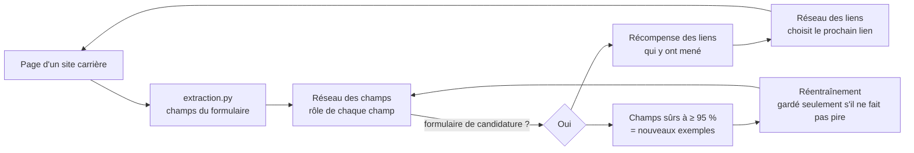

# Apprentissage — comprendre les sites carrières (mini-projet)

Mini-projet de deep learning, **séparé de l'application CandiPilot** : il n'importe rien de `app/`
ni de `src/`, et l'application ne l'utilise pas encore. Il sera intégré plus tard, comme remplisseur
« appris » pour les sites carrières à côté de `src/adapters/generic.py`.

Il lit des pages et apprend, **sans jamais remplir ni envoyer de formulaire**.

## Ce que fait l'algorithme



1. **Réseau des champs** (`modeles/reseau.py`, PyTorch) : pour chaque champ (libellé, nom technique,
   type, texte voisin, position), il prédit son rôle parmi `etiquettes.LABELS` (prénom, e-mail, CV,
   lettre, bouton Postuler…). Le texte est lu en mots et morceaux de 3 lettres, ce qui marche en
   français comme en anglais.
2. **Réseau des liens** (navigation) : pour chaque lien, il estime la probabilité qu'il mène à un
   formulaire de candidature. Il est récompensé quand il en trouve un, et les liens précédents du
   chemin reçoivent une part de la récompense. Il garde 15 % d'exploration au hasard pour continuer
   à découvrir.
3. **Boucle autonome** (`autonome.py`) : il démarre sur des formulaires générés (`synthetique.py`),
   explore les sites, transforme ce dont il est sûr en nouveaux exemples, puis se réentraîne. Le jeu
   de validation l'empêche de « désapprendre » : un modèle moins bon est refusé.

## Résultats (sites générés en local)

| Mesure | Règles / hasard | Réseau |
|---|---|---|
| Rôle des champs (formulaires jamais vus) | 90,7 % | 99,9 % |
| Pages pour trouver tous les formulaires d'un site | 22 | 10 à 13 (10 = minimum possible) |

Sur de vrais sites, les scores seront plus bas au début : c'est en explorant et en ajoutant des
pages vérifiées à la main qu'il progresse.

## Utilisation

```bash
cd apprentissage
../.venv/bin/python -m pip install -r requirements.txt   # une fois
../.venv/bin/python autonome.py --demo     # démonstration sur des sites générés (aucun vrai site)
../.venv/bin/python autonome.py            # vrais sites de config.yaml : apprend et sauvegarde
../.venv/bin/python collecte.py            # collecte simple des pages (sans réseau de neurones)
../.venv/bin/python evaluation.py reseau   # précision sur les pages vérifiées à la main
```

## Protocole : lancer l'apprentissage sur de vrais sites

**1. Choisir les sites.** Pour chaque entreprise, prendre l'adresse de sa **page carrières**
(l'algorithme trouve seul les offres et les formulaires à partir de là). Vérifier que les conditions
d'utilisation du site autorisent la lecture automatique.

**2. Les ajouter dans [config.yaml](config.yaml)**, en remplaçant `sites: []` (deux espaces avant
`- nom`, quatre avant `url`), puis enregistrer :

```yaml
sites:
  - nom: Greenhouse Exemple
    url: https://boards.greenhouse.io/nomdelentreprise
  - nom: Autre entreprise
    url: https://www.entreprise.com/carrieres
```

**3. Lancer**, depuis le terminal de VS Code :

```bash
cd ~/Downloads/job-rpa/apprentissage
../.venv/bin/python autonome.py
```

- Premier lancement : apprentissage de départ (~30 s), puis exploration site par site.
- Pour chaque site : pages visitées, puis un bilan (formulaires trouvés, nouveaux exemples appris,
  précision, modèle gardé ou refusé).
- 5 s d'attente entre deux pages : environ 2 minutes pour 20 pages par site.
- `Ctrl + C` pour arrêter ; ce qui est appris est enregistré après chaque site terminé.

**4. Si un site affiche « échec » sur toutes ses pages** (navigateur invisible bloqué), mettre
`navigateur_visible: true` dans `config.yaml` : une fenêtre Chrome s'ouvre et montre la navigation.

**5. Suivre les progrès** : un bilan par site dans `donnees/journal.jsonl`. Chaque lancement repart
de ce qui a déjà été appris (`modeles/sauvegardes/`, `donnees/pseudo.jsonl`).

Réglages de `config.yaml` : `delai_secondes` (pause entre deux pages), `pages_max_par_site`,
`profondeur_max` (clics depuis la page de départ), `mots_cles_liens` (pour `collecte.py`).
L'exploration respecte toujours `robots.txt` et ne remplit ni n'envoie aucun formulaire.

**Améliorer le modèle à la main** : dans `donnees/brutes/<site>/*.json` (créés par `collecte.py`),
corriger les `"etiquette"` fausses puis passer `"verifiee": true`. Ces pages comptent double à
l'entraînement et servent de juge pour accepter ou refuser un nouveau modèle.

## Fichiers

| Fichier | Rôle |
|---|---|
| `extraction.py` | Lit le HTML et liste les champs du formulaire avec leurs caractéristiques |
| `etiquettes.py` | Les rôles à reconnaître (le contrat avec le robot) et les règles de référence |
| `synthetique.py` | Formulaires et petits sites générés, avec la bonne réponse |
| `modeles/reseau.py` | Les deux réseaux de neurones (PyTorch) |
| `modeles/__init__.py` | Choix du modèle : `regles` ou `reseau` |
| `autonome.py` | La boucle d'exploration et d'apprentissage autonome |
| `collecte.py` | Collecte simple de pages, pré-étiquetées par les règles |
| `evaluation.py` | Mesure la précision d'un modèle |
| `donnees/` | Pages collectées, pseudo-étiquettes, journal des progrès (non publié sur GitHub) |
| `modeles/sauvegardes/` | Réseaux appris (non publiés sur GitHub) |

## Tests

```bash
.venv/bin/python apprentissage/tests/test_apprentissage.py   # extraction, règles, isolation (24)
.venv/bin/python apprentissage/tests/test_autonome.py        # réseaux et exploration autonome (13)
```

## Intégration future dans CandiPilot (quand ce sera décidé)

Le contrat est `predire(champs) -> étiquettes` (voir `modeles/__init__.py`) : un adaptateur
`src/adapters/appris.py` lira la page, demandera le rôle de chaque champ au réseau, puis remplira
avec le profil du candidat, en gardant les règles de l'application (validation finale, preuve
d'envoi, pas de doublon).
