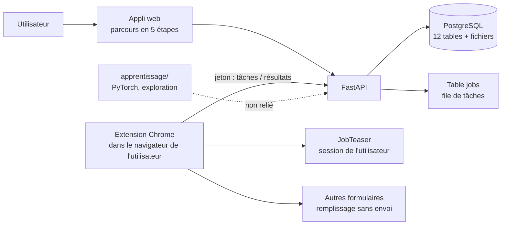
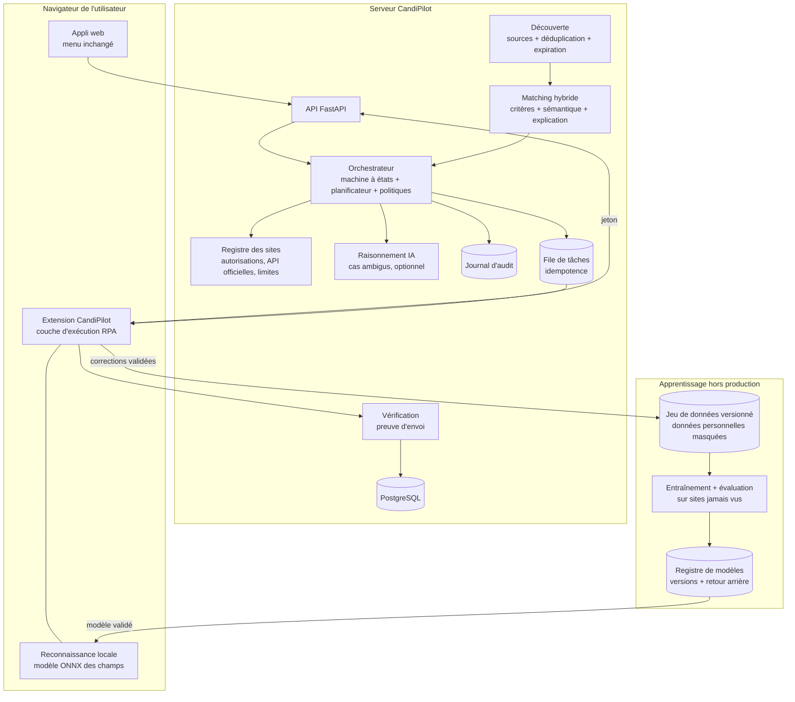
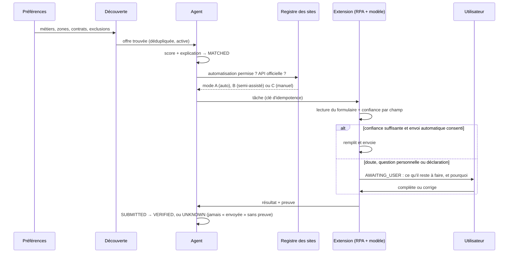

# CandiPilot — Audit de l'existant et architecture cible

*Phase 1 (audit) et phase 2 (architecture) du cahier des charges « plateforme autonome ». Rédigé le 25 octobre 2026.
Aucune modification du code n'a été faite pour ce document. Le menu de l'application ne change pas.*

---

## 1. Audit de l'existant

### 1.1 Composants

| Composant | Emplacement | Technologie | Taille | État |
|---|---|---|---|---|
| Application web (SPA) | `app/static/` | HTML + CSS + JavaScript sans framework | ~1 200 lignes | En production |
| API | `app/main.py`, `agent.py`, `workflow.py`, `worker.py`, `auth.py` | Python 3.9/3.11, FastAPI, Uvicorn | 73 routes | En production |
| Base de données | `app/db.py`, `files.py` | PostgreSQL (Neon, Francfort) en ligne ; SQLite en local et en test | 12 tables | En production |
| Robot dans le navigateur | `extension/` | Extension Chrome MV3 | ~640 lignes | Fonctionnel, non publié sur le Store |
| Robot « local » (Playwright) | `src/` + `app/worker.py` (mode `local`) | Playwright + Chromium | ~1 550 lignes | Ancien moteur, adaptateurs ATS non testés récemment |
| Apprentissage (deep learning) | `apprentissage/` | PyTorch (réseaux de type fastText), exploration autonome | séparé de l'appli | Non intégré au produit |
| Tests | `tests/`, `apprentissage/tests/` | Scripts Python + Playwright | API 62, parcours 103, interface, extension 24, apprentissage 48 | Automatisés (GitHub Actions) |
| Hébergement | `Dockerfile`, `render.yaml`, `release.sh` | Render (offre gratuite) + Neon (gratuit) | — | En ligne : https://candipilot.onrender.com |

### 1.2 Fonctionnement actuel

- **Données** : profil, documents (contenu en base, table `files`), préférences, offres, candidatures,
  événements, tâches. Statuts : `decouverte → qualifiee → preparation → a_valider → soumission →
  confirmee`, plus `echec`, `incertaine`, `ignoree`.
- **Découverte des offres** : une seule source, JobTeaser, via l'extension et la session de l'utilisateur.
- **Matching** : `app/matching.py`, score sur 100 par mots-clés (intitulé, compétences, contrat, zone,
  date). Lisible, mais sans compréhension du sens (« M&A » ≠ « fusions-acquisitions »).
- **Navigation et remplissage** : sélecteurs JobTeaser fixes (`extension/jobteaser.js`) ; ailleurs, des
  règles par mots-clés (`extension/filler.js`) qui ne soumettent jamais.
- **Orchestration** : pas d'agent IA. Une machine à états, une file de tâches, des règles de blocage
  (`workflow.py`) et une validation humaine finale (« Valider et démarrer le robot »).
- **Deep learning** : classifieur de champs PyTorch, 92,9 % de champs justes sur un juge de 9 vrais
  formulaires (contre 76,7 % pour les règles). Il n'est pas branché sur l'extension.

### 1.3 Points forts à conserver

1. **Architecture « robot dans le navigateur de l'utilisateur »** : aucun mot de passe confié, pas de
   serveur à navigateurs, passage à l'échelle naturel. C'est le bon choix pour un SaaS.
2. **Règles de sûreté déjà en place** : pas d'envoi sans validation finale, pas de doublon
   (`submit_guard`), « Envoyée » seulement avec une preuve, statut « incertaine » si le doute existe.
3. **Parcours en 5 étapes**, menu et charte graphique, que tu veux garder.
4. **Tests automatisés** de bout en bout (faux portail JobTeaser, extension réelle dans Chromium).
5. **Juge réel** pour l'apprentissage : un nouveau modèle n'est gardé que s'il ne recule pas.

### 1.4 Faiblesses et risques

| # | Domaine | Constat | Gravité |
|---|---|---|---|
| R1 | Juridique | Automatiser JobTeaser (et d'autres plateformes) peut être contraire à leurs conditions d'utilisation : rien n'a été vérifié site par site. Il n'existe pas de registre des autorisations par site. | **Élevée** |
| R2 | Base de données | Évolutions du schéma par `ALTER TABLE` ajoutés au démarrage, sans versions ni retour arrière ; SQL traduit de SQLite vers PostgreSQL à la volée. | Moyenne |
| R3 | Fiabilité | La file de tâches tourne dans le même processus que le site. Pas de clé d'idempotence par envoi (seulement une vérification de doublon par adresse d'offre). | Moyenne |
| R4 | Découverte | Une seule source (JobTeaser) ; pas de détection des offres expirées ni des doublons entre sources. | Élevée pour le produit |
| R5 | Matching | Mots-clés seulement, pas de sens, explication limitée. | Moyenne |
| R6 | Robot | Sites avec composants isolés (shadow DOM, cadres) non lus : Workday/Phenom, Thales, Adobe, PayPal. Formulaires en plusieurs étapes non gérés hors JobTeaser. | Élevée |
| R7 | Deep learning | Modèle hors produit ; juge petit (9 formulaires) et en partie connu ; pas de jeu de données versionné, pas de masquage des données personnelles, pas de registre de modèles ni de retour arrière. | Moyenne |
| R8 | Sécurité | Cookie `SameSite=Lax` sans jeton anti-CSRF ; limitation de débit en mémoire (perdue au redémarrage) ; fichiers non chiffrés au repos (seulement par Neon) ; pas de journal d'audit dédié. | Moyenne |
| R9 | RGPD | Suppression de compte en cascade : oui. Export des données : non. Durée de conservation : non définie. Consentement explicite à l'envoi automatique : seulement implicite (choix du mode). | Moyenne |
| R10 | Hébergement | Render gratuit : un dixième de processeur, 512 Mo de mémoire, mise en veille. Le déclenchement automatique depuis GitHub ne fonctionne pas (déploiement par `release.sh`). Neon gratuit : 0,5 Go. | Moyenne |
| R11 | E-mails | « Mot de passe oublié » : envoi Brevo pas encore configuré (clé API manquante). | Faible |
| R12 | Écart avec ta validation | Le panneau « E-mails (administrateur) » de « Mon compte » est en production alors que tu avais refusé cette modification (erreur de ma part, voir le compte rendu). | Faible |

### 1.5 Que garder, refactorer, étendre, remplacer

| Garder | Refactorer | Étendre | Remplacer |
|---|---|---|---|
| FastAPI, SPA sans framework, menu, extension, PostgreSQL/Neon, file `jobs`, règles de sûreté, tests | `db.py` → migrations versionnées ; `worker.py` → orchestrateur à états explicites ; `matching.py` → score hybride expliqué | Sources d'offres, adaptateurs ATS, statuts, journal d'audit, apprentissage branché sur l'extension | Rien de lourd. Le robot Playwright « local » (`src/`) passe en mode maintenance, puisque l'extension le remplace. |

---

## 2. Architecture cible

### 2.1 Vue d'ensemble

**Principe directeur** : l'agent **décide**, le deep learning **reconnaît**, l'extension **exécute**. La
machine à états reste la seule source de vérité : l'IA propose, des règles déterministes autorisent.

### 2.2 Flux d'une candidature

### 2.3 Statuts (machine à états)

Les valeurs actuelles en base sont conservées et complétées, sans renommage destructif :

| Cahier des charges | Valeur en base | Existe déjà ? |
|---|---|---|
| DISCOVERED | `decouverte` | oui |
| MATCHED | `qualifiee` | oui |
| QUEUED | `en_file` | **nouveau** |
| IN_PROGRESS | `preparation` / `soumission` | oui |
| AWAITING_USER | `attente_utilisateur` | **nouveau** (aujourd'hui confondu avec `a_valider`) |
| SUBMITTED | `soumise` | **nouveau** (envoyée, preuve pas encore vérifiée) |
| VERIFIED | `confirmee` | oui |
| FAILED / UNKNOWN / CANCELLED / REJECTED / EXCLUDED | `echec` / `incertaine` / `annulee` / `refusee` / `ignoree` | 3 sur 5 existent |

Chaque transition est contrôlée (table des transitions permises) et écrite dans le journal d'audit.

### 2.4 Choix techniques et justifications

| Sujet | Choix proposé | Pourquoi | Alternative écartée |
|---|---|---|---|
| Interface | Garder la SPA sans framework ; ajouter des jetons de design et un mode sombre | Pas de réécriture, menu intact, rapide | React/Next.js : réécriture complète, aucun gain pour l'utilisateur à ce stade |
| Base | PostgreSQL + **migrations versionnées** (table `schema_migrations`, fichiers SQL numérotés) | Déploiements sûrs et retour arrière | Alembic/ORM : lourd pour 12 tables |
| File de tâches | Table `jobs` + `FOR UPDATE SKIP LOCKED` + clé d'idempotence | Suffisant jusqu'à des milliers d'utilisateurs, coût nul | Redis/Celery : un service payant de plus |
| Découverte | 1) API publiques des ATS (Greenhouse, Lever, Ashby, SmartRecruiters, Workable) ; 2) données structurées `JobPosting` (schema.org) des pages carrières, avec `robots.txt` et plans de site ; 3) JobTeaser par la session de l'utilisateur (sous réserve juridique, R1) | Sources prévues pour être lues, fiables, sans contournement | Interroger Google ou Bing automatiquement : interdit par leurs conditions sans API payante |
| Matching | Score hybride : critères stricts (contrat, zone, date, langue, exclusions) + similarité sémantique (embeddings multilingues) + phrase d'explication | Comprend « M&A » = « fusions-acquisitions », et reste explicable | LLM seul : coûteux et non reproductible |
| Reconnaissance | Modèle actuel exporté en **ONNX**, exécuté dans l'extension (onnxruntime-web) | Rapide, sans serveur, aucune donnée envoyée pour reconnaître un champ | PyTorch sur Render gratuit : 512 Mo, trop juste |
| Agent IA | Orchestrateur déterministe + **LLM optionnel** (Claude) pour les formulaires ambigus, la planification et l'explication | L'IA aide sans jamais être seule juge : seuils de confiance et validation humaine | Agent LLM autonome sans garde-fous : risque de candidatures inventées |
| Pages isolées (shadow DOM) | Lecture du shadow DOM et des cadres dans l'extension (accès au DOM rendu) | Débloque Workday/Phenom | Vision (captures d'écran) : en dernier recours seulement |

### 2.5 Changements de base de données prévus

| Table / colonne | Rôle |
|---|---|
| `schema_migrations(version, applied_at)` | Versions du schéma |
| `site_policies(domain, platform, mode_max, official_api, terms_checked_at, notes, rate_limit)` | Registre des autorisations par site (R1) |
| `job_sources`, `offers.source_id`, `offers.fingerprint`, `offers.expires_at`, `offers.last_seen_at`, `offers.description`, `offers.skills` | Sources multiples, doublons, expiration |
| `preferences` : `remote`, `experience_level`, `min_salary`, `languages`, `include_companies`, `exclude_companies`, `exclude_keywords`, `auto_submit_consent_at`, `daily_limit` | Préférences du cahier des charges, consentement explicite |
| `applications.idempotency_key`, `applications.match_explanation`, `applications.mode` (A/B/C) | Pas de double envoi, explication, mode |
| `audit_log(id, user_id, application_id, actor, action, from_status, to_status, detail, created_at)` | Traçabilité |
| `assist_requests(id, application_id, field, reason, resolved_at)` | Mode semi-assisté : ce que l'utilisateur doit faire |
| `training_examples(id, dataset_version, site, html_hash, fields_masked, labels, source, validated_by, created_at)` | Apprentissage (données personnelles masquées) |
| `models(version, metrics, created_at, active)` | Registre de modèles, retour arrière |

### 2.6 Nouvelles API (résumé)

| Méthode | Route | Rôle |
|---|---|---|
| GET/PUT | `/api/preferences` (étendue) | Nouvelles préférences, consentement à l'envoi automatique |
| GET | `/api/offers?sort=score` + `match_explanation` | Offres classées et expliquées |
| GET/POST | `/api/assist` | Demandes d'intervention (mode B) et leurs réponses |
| GET | `/api/applications/{id}/history` | Journal d'audit d'une candidature |
| GET | `/api/agent/model` | Version active du modèle ONNX (téléchargé par l'extension) |
| POST | `/api/agent/observations` | Corrections validées, données personnelles masquées |
| GET | `/api/admin/quality` | Indicateurs : précision des champs, taux d'intervention, doublons, fausses confirmations |
| GET | `/api/me/export`, `DELETE /api/me` | RGPD : export et effacement |

### 2.7 Pipeline d'apprentissage (pas d'apprentissage en ligne non contrôlé)

1. L'extension envoie **uniquement les corrections validées par l'utilisateur** et les formulaires
   terminés avec preuve. Les valeurs saisies sont remplacées par leur type (`<EMAIL>`, `<NOM>`…).
2. Le serveur les range dans un **jeu de données versionné** (`training_examples`).
3. Un entraînement **hors ligne** (sur ton Mac ou dans GitHub Actions) produit un modèle candidat.
4. Évaluation sur des **sites jamais vus** (découpage par site, pas par page) et sur le juge.
5. Publication dans le **registre** seulement s'il fait mieux ; **retour arrière** en un clic.
6. L'extension télécharge la version active ; chaque prédiction est enregistrée avec sa version.

---

## 3. Phases priorisées

| Lot | Contenu | Pourquoi dans cet ordre | Livrables testables |
|---|---|---|---|
| **1. Fondations** | Migrations versionnées, statuts complétés, journal d'audit, clés d'idempotence, registre des sites, consentement explicite à l'envoi automatique, jeton anti-CSRF, limitation de débit en base | Tout le reste s'appuie dessus ; corrige R1, R2, R3, R8 | Tests de migration, de transitions, de non-doublon |
| **2. Découverte multi-sources** | Adaptateurs Greenhouse / Lever / Ashby / SmartRecruiters / Workable (API publiques), `JobPosting` des pages carrières, déduplication, expiration, planificateur | Le plus de valeur pour l'utilisateur : bien plus d'offres, légalement | Faux serveurs d'API dans les tests |
| **3. Matching hybride** | Critères + sémantique + explication, nouvelles préférences | Classe les nouvelles offres | Jeu de test d'offres annoté |
| **4. Exécution et reconnaissance** | Modèle ONNX dans l'extension, adaptateurs Greenhouse/Lever en mode semi-assisté, lecture du shadow DOM, formulaires en plusieurs étapes, seuils de confiance | Débloque les ATS courants | Faux portails Greenhouse/Lever/Workday dans les tests |
| **5. Agent et intervention humaine** | Planificateur, choix du mode A/B/C, `attente_utilisateur` avec reprise, explications, limites quotidiennes, LLM optionnel | S'appuie sur 1 à 4 | Tests de décisions de l'agent |
| **6. Expérience utilisateur** | Accueil centré sur l'action, formulaires simplifiés (listes, multi-sélection), extraction du CV à valider, mode sombre, écrans vides / chargement / erreur. **Menu inchangé.** | Après que les fonctions existent | Tests d'interface (mobile et ordinateur) |
| **7. Pipeline d'apprentissage** | Jeu de données versionné, masquage, évaluation sur sites jamais vus, registre, retour arrière, indicateurs de qualité | Nécessite les corrections du lot 4 | Tests du masquage et du retour arrière |
| **8. Production** | **Seulement avec ton accord** : sauvegarde, migrations, déploiement, tests en ligne, plan de retour arrière | — | Compte rendu de mise en production |

Chaque lot est développé et testé **en local**, poussé sur `develop` seulement, puis présenté (résumé,
captures, résultats des tests, limites) avant toute demande de mise en production.

---

## 4. Risques anticipés

| Risque | Mesure |
|---|---|
| Conditions d'utilisation des plateformes (JobTeaser, Welcome to the Jungle, LinkedIn) | Registre des sites : mode C par défaut tant que l'automatisation n'est pas vérifiée comme permise ; API officielles en priorité |
| CAPTCHA, protections anti-robots | Jamais contournés : passage en mode semi-assisté ou manuel |
| Coût du LLM | Optionnel, plafonné par utilisateur et par jour, utilisé seulement en cas d'ambiguïté |
| Hébergement gratuit (512 Mo, 0,1 processeur) | Reconnaissance dans l'extension, embeddings légers ou calculés hors du site ; offre payante (environ 7 $ par mois) avant d'ouvrir à de vrais utilisateurs |
| Qualité du modèle | Évaluation sur sites jamais vus, registre de modèles, retour arrière, aucun réentraînement automatique en production |
| Ampleur du cahier des charges | Il représente plusieurs mois de travail d'équipe : livraison par lots utilisables, sans démonstrations factices |
