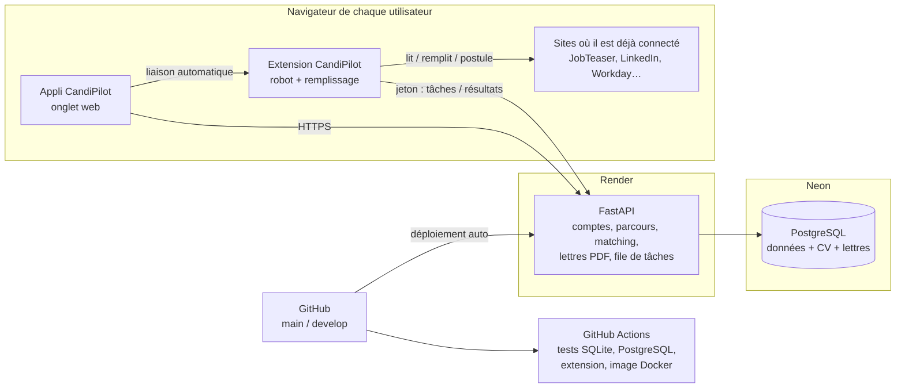

# Architecture de déploiement — CandiPilot

## Vue d'ensemble

Le serveur est hébergé sur **Render** (site, gratuit) avec une base PostgreSQL chez **Neon** (gratuite). Le robot ne tourne plus sur un
serveur : il tourne dans **l'extension CandiPilot du navigateur de chaque utilisateur**, avec les
sessions que l'utilisateur a déjà (JobTeaser, LinkedIn…). Aucun mot de passe n'est confié à CandiPilot,
les protections anti-robots ne bloquent pas un vrai navigateur, et chaque utilisateur fait son propre
travail : le service passe à l'échelle sans machine dédiée.

## Le robot dans l'extension

1. **Installation** : l'utilisateur télécharge l'extension depuis l'appli (`/extension.zip`) et la charge
   dans Chrome (mode développeur), en attendant sa publication sur le Chrome Web Store.
2. **Liaison** : dès qu'il ouvre CandiPilot en étant connecté, l'extension reçoit un jeton
   (`POST /api/agent/link`). Rien à saisir.
3. **Sites** : l'extension vérifie sur quels sites l'utilisateur est connecté et le signale
   (`PUT /api/agent/sites`). Le portail JobTeaser de son école est déduit de ses cookies.
4. **Tâches** : toutes les 30 s, elle demande ses tâches (`GET /api/agent/next`) — recherche, lecture
   d'un formulaire, candidature, vérification — et les exécute dans un onglet « robot » réduit, puis
   renvoie le résultat. Les règles restent sur le serveur : pas d'envoi sans « Valider et démarrer »,
   pas de doublon, « Envoyée » seulement avec une preuve.
5. **N'importe quel site** : le bouton « Remplir ce formulaire » de l'extension remplit le formulaire de
   l'onglet ouvert (Workday, Greenhouse, site d'entreprise…) sans jamais l'envoyer.

Fichiers : `extension/` (manifest, `background.js`, robot `jobteaser.js`, remplisseur `filler.js`,
liaison `link.js`, fenêtre `popup.*`) ; côté serveur `app/agent.py`.

## Environnements

| | Production | Recette | Développement local |
|---|---|---|---|
| Hébergement | Render (`render.yaml`) | Mac : `./deploy.sh recette` | Mac : `./start.sh` |
| Branche | `main` (déploiement automatique) | `develop` | branche de travail |
| Base | PostgreSQL Neon | SQLite `data-recette/` | SQLite `data/` |
| Robot | extension des utilisateurs | simulé | extension, ou `CANDIPILOT_ROBOT=local` |

**Production : https://candipilot.onrender.com** (Render, Francfort ; base Neon, Francfort `eu-central-1`).
La base doit être dans la même région que le site : avec une base aux États-Unis, chaque requête traversait
l'Atlantique (page d'accueil 8 s → 0,2 s après le passage en Europe, 25 octobre 2026).

**Mettre à jour la production** : `./release.sh` (tests → version locale → GitHub → déploiement Render par son API,
`RENDER_API_KEY` dans `.env`). Le déclenchement automatique de Render depuis GitHub ne fonctionne pas sur ce compte.

## Mettre en ligne (une fois)

1. **Neon** (neon.tech) : dans le projet, bouton **Connect** → copier l'adresse de connexion
   (`postgresql://…neon.tech/…?sslmode=require`).
2. **Render** (render.com, compte de WeSkool) : **New → Blueprint**, dépôt **sodara-cpu/CandiPilot**,
   branche **main**. Render demande `DATABASE_URL` : coller l'adresse Neon, puis **Apply**.
   (Les champs `CANDIPILOT_SMTP_*` peuvent rester vides au début.) Les tables sont créées au premier démarrage.
3. Chaque push sur `main` redéploie automatiquement.

Offres gratuites : le site Render se met en veille après 15 min sans visite (réveil en ~1 min) ;
la base Neon gratuite (0,5 Go) n'expire pas.

## Branches et cycle de livraison

1. On développe sur `develop`. Chaque push lance les tests GitHub Actions (`.github/workflows/ci.yml`) :
   SQLite, PostgreSQL, extension de bout en bout, construction de l'image Docker, mini-projet d'apprentissage.
2. On vérifie en recette (`git checkout develop && ./deploy.sh recette`).
3. On fusionne dans `main` : Render redéploie la production.

## Configuration (variables d'environnement)

| Variable | Rôle |
|---|---|
| `DATABASE_URL` | PostgreSQL (adresse Neon) ; sans elle, SQLite dans `CANDIPILOT_DATA` |
| `CANDIPILOT_ROBOT` | `extension` (défaut), `local` (robot Playwright sur le serveur) ou `simule` |
| `CANDIPILOT_FAKE_ROBOT=1` | robot simulé (tests) |
| `CANDIPILOT_SECURE_COOKIE=1` | cookie de session en HTTPS uniquement |
| `CANDIPILOT_TRUST_PROXY=1` | adresse IP réelle des visiteurs derrière le proxy de Render |
| `CANDIPILOT_PUBLIC_URL` | adresse publique des e-mails (Render : `RENDER_EXTERNAL_URL` automatique) |
| `CANDIPILOT_SMTP_HOST`, `_PORT`, `_USER`, `_PASSWORD`, `_FROM` | e-mails « mot de passe oublié » |

En local, ces réglages privés se mettent dans `.env` (modèle `.env.example`), chargé par `start.sh` et `deploy.sh`.

## Données et sécurité

- CV et lettres sont stockés dans la base (table `files`) : le disque de Render est effacé à chaque déploiement.
- Le jeton de l'extension ne donne accès qu'aux données de son propriétaire ; seule son empreinte est stockée.
- Jamais publiés sur GitHub (`.gitignore`) : `.env`, `.user-profile/`, `config/profile.yaml`,
  `config/offers.csv`, `data/`, `data-recette/`, `output/`.

## Limites connues

- L'extension doit être chargée en mode développeur tant qu'elle n'est pas publiée sur le Chrome Web Store
  (compte développeur Google : 5 $ une fois).
- Les tâches attendent que le navigateur de l'utilisateur soit ouvert (l'extension travaille quand Chrome tourne).
- Robot complet : JobTeaser. LinkedIn et Welcome to the Jungle : détection de connexion. Autres sites :
  remplissage du formulaire ouvert, l'utilisateur envoie lui-même.
