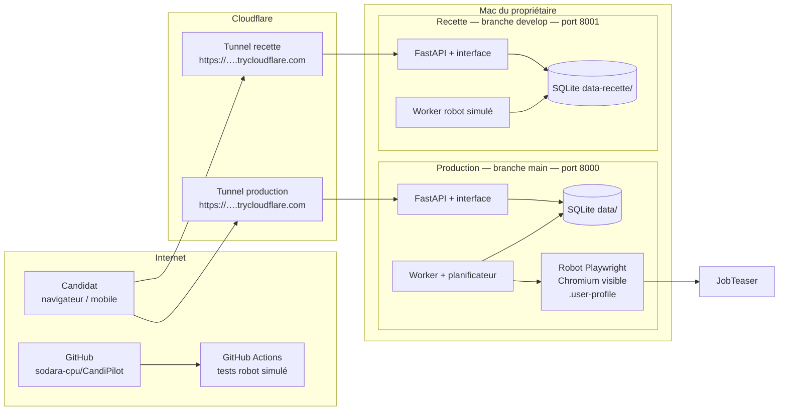
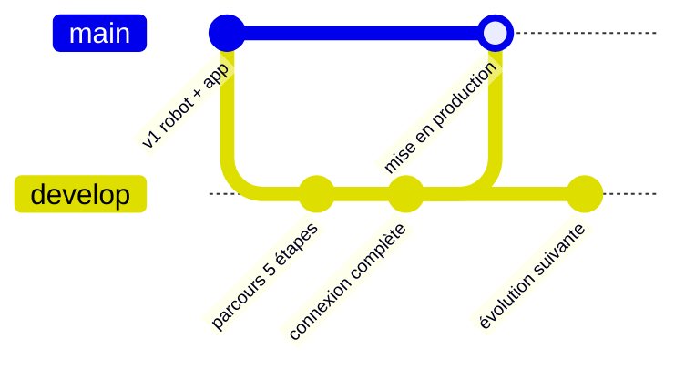

# Architecture de déploiement — CandiPilot (prototype)

## Vue d'ensemble

CandiPilot est hébergé sur le Mac du propriétaire : le robot a besoin d'un navigateur **visible**
(JobTeaser est protégé par Cloudflare) et de la session SSO SKEMA/JobTeaser de son propriétaire,
ce qu'un serveur en ligne classique ne peut pas fournir. Un tunnel Cloudflare donne une adresse
https publique à chaque environnement.

## Environnements

| | Production | Recette | Développement local |
|---|---|---|---|
| Branche | `main` | `develop` | branche de travail |
| Commande | `./deploy.sh` | `./deploy.sh recette` | `./start.sh` |
| Port local | 8000 | 8001 | 8000 |
| Robot | **réel** (envoie de vraies candidatures) | simulé, aucun envoi | réel, ou simulé avec `CANDIPILOT_FAKE_ROBOT=1` |
| Données | `data/` | `data-recette/` | `data/` |
| Adresse | lien `trycloudflare.com` | autre lien `trycloudflare.com` | http://127.0.0.1:8000 |

Les deux environnements ont des bases séparées : un compte de recette n'existe pas en production.
Un même dossier de code ne contient qu'une branche à la fois : on déploie la recette depuis
`develop` (`git checkout develop`), la production depuis `main`.

## Branches et cycle de livraison

1. On développe sur `develop` (ou sur une branche partant de `develop`).
2. Chaque push déclenche les tests GitHub Actions (`.github/workflows/ci.yml`).
3. On vérifie l'évolution en recette : `git checkout develop && ./deploy.sh recette`.
4. Quand c'est validé, on fusionne `develop` dans `main` puis on redéploie la production :
   `git checkout main && git merge develop && git push && ./deploy.sh`.

## Intégration continue

`tests/run_all.sh` démarre un serveur temporaire en robot simulé puis lance :
- `tests/test_api.py` — API, authentification, CRUD, cycle de vie des candidatures ;
- `tests/test_workflow.py` — parcours en 5 étapes, 3 modes, 4 combinaisons préparation/relecture,
  aucun envoi avant confirmation, mot de passe oublié ;
- `tests/test_ui.py` — parcours complet dans un navigateur.

Le même script tourne en local (`./tests/run_all.sh`) et sur GitHub.

## Configuration (variables d'environnement)

| Variable | Rôle |
|---|---|
| `CANDIPILOT_DATA` | dossier de la base et des fichiers (défaut `data/`) |
| `CANDIPILOT_FAKE_ROBOT=1` | robot simulé, aucun envoi réel |
| `CANDIPILOT_SECURE_COOKIE=1` | cookie de session en HTTPS uniquement (mis par `deploy.sh`) |
| `CANDIPILOT_PUBLIC_URL` | adresse publique utilisée dans les e-mails (mise par `deploy.sh`) |
| `CANDIPILOT_SMTP_HOST`, `_PORT`, `_USER`, `_PASSWORD`, `_FROM` | envoi des e-mails « mot de passe oublié » ; sans eux, le lien est écrit dans `server.log` |

Ces réglages privés se mettent dans `.env` (modèle : `.env.example`), chargé par `start.sh` et `deploy.sh`.

## Données et sécurité

- Chaque utilisateur connecte son propre JobTeaser (connexion à distance, étape 3) ; ses cookies restent
  dans `data/navigateurs/<id>`. Le robot réel n'agit jamais sans le compte de la personne connectée.
- Jamais publiés sur GitHub (`.gitignore`) : `.env`, `.user-profile/` (cookies JobTeaser/SKEMA),
  `config/profile.yaml`, `config/offers.csv`, `data/`, `data-recette/`, `output/`.
- Sauvegarde : copier `data/` (base SQLite, CV, lettres) avec l'application arrêtée.

## Limites connues

- Le service n'est disponible que quand le Mac est allumé et `deploy.sh` lancé.
- L'adresse `trycloudflare.com` change à chaque lancement (un tunnel nommé Cloudflare, avec un compte
  et un nom de domaine, donnerait une adresse fixe).
- Un seul robot réel à la fois (une seule session navigateur partagée).
- Évolution prévue par le dossier de conception : Next.js / NestJS / PostgreSQL sur un hébergeur,
  avec des canaux de candidature autorisés à la place du robot navigateur.
