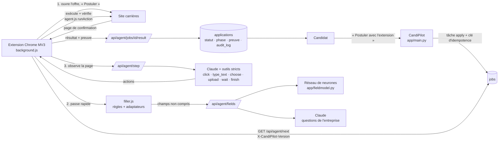

# Moteur de candidature sur les sites des entreprises

État au 26/10/2026 (extension 0.6.0). Ce document décrit ce qui est **réellement testé**, **simulé**, ou **non vérifié**.

## 1. Architecture

Séparation : Claude **décide** (planification, questions, navigation imprévue) ; l'extension **exécute** de façon
déterministe et **vérifie** chaque action (valeur relue, fichier attaché, erreurs de validation du site relevées).
Claude n'est appelé que pour ce que les règles et le réseau ne savent pas faire.

## 2. Parcours et état de chaque étape

| Étape | Code | État |
|---|---|---|
| Lancer la candidature | `POST /api/applications/{id}/apply` (main.py) | ✅ testé |
| Transmission à l'extension | `GET /api/agent/next` (agent.py) ; refus si extension < 0.6.0 | ✅ testé |
| Ouverture de l'offre, bouton « Postuler », choix intermédiaire (Workday) | `openApplyForm` (background.js) | ✅ testé (site de test) ; ✅ Workday réel jusqu'au compte |
| Remplissage rapide (règles, adaptateurs, réseau, Claude) | filler.js, /api/agent/fields | ✅ testé ; ✅ Ashby réel |
| Agent Claude (navigation, étapes, listes, choix, conditionnels) | agent.js, /api/agent/step, llm.agent_step | ✅ testé avec le vrai Claude (site de test) |
| Pièces jointes | `upload`, `setFile` ; vérification « fichier attaché » | ✅ fichier reçu entier par le site de test |
| Validation | erreurs du site relevées et renvoyées à Claude ; boucle détectée → arrêt explicite | ✅ testé |
| Envoi final | seulement si le candidat a choisi l'envoi automatique (mode auto + consentement) | ✅ testé |
| Confirmation | phrase de confirmation + texte autour (référence) + adresse = preuve | ✅ testé |
| Base de données | `statut`, `phase`, `preuve`, `audit_log` (chaque changement d'étape) | ✅ testé |
| Suivi par le candidat | fiche candidature : étape en clair, « Arrêter », « Reprendre l'envoi » | ✅ testé |

## 3. Étapes (phase) et statuts

`applications.phase` (migration 7) : OPENING → FILLING → READY_TO_SUBMIT → SUBMITTING → SUBMITTED, ou
AUTHENTICATION_REQUIRED, HUMAN_ACTION_REQUIRED, UNSUPPORTED, FAILED. Statuts existants conservés :
`soumission` (en cours), `attente_utilisateur` (à toi de jouer), `confirmee` (envoyée **avec confirmation du site**),
`incertaine` (pas de confirmation), `echec`. Reprise sans double envoi : même clé d'idempotence.

## 4. Causes racines corrigées (26/10/2026)

1. **Version de l'extension inconnue du serveur** (enregistrée seulement à la liaison) → tâches confiées à une
   extension incapable (« Tâche inconnue : apply » en production). Corrigé : en-tête `X-CandiPilot-Version` à chaque
   appel, `MIN_VERSION`, message « mets à jour l'extension ». (agent.py, background.js)
2. **Liste déroulante non choisie vue comme remplie** (« Choisir… »). (agent.js)
3. **Étapes sans changement d'adresse** : la passe rapide ne repassait pas. Signature de page = adresse + champs. (background.js)
4. **Boucles sans fin** : même action répétée 25 fois. Détection → arrêt avec les erreurs du site. (background.js)
5. **Aucune vérification** après action. Valeur relue, fichier vérifié, erreurs de validation observées. (agent.js)
6. **Preuve sans référence** : texte autour de la confirmation ajouté. (background.js)
7. **Pas d'arrêt possible, pas d'étape persistée** : `POST /api/applications/{id}/stop`, `phase` + audit. (main.py, agent.py)
8. Réseau : 3 essais avec attente croissante ; coût de chaque appel Claude dans les journaux (`cost_usd`).

## 5. Compatibilité réelle des plateformes

| Plateforme | Niveau | Vérification |
|---|---|---|
| Site de test complet (3 étapes, conditionnel, validation, envoi, confirmation) | Envoi automatique de bout en bout | ✅ vrai Claude, `tests/e2e_agent_reel.py` (39 s, 0,02 $) |
| Ashby (Voodoo) | Formulaire rempli sauf salaire / visa / consentement | ✅ vrai site, **sans envoi** |
| Workday (PwC) | Jusqu'à la création de compte (e-mail prérempli) | ✅ vrai site ; compte et mot de passe : le candidat |
| Greenhouse, Lever | Adaptateurs + agent | ⚠️ testés sur imitations seulement (essai réel bloqué par le garde-fou de Claude Code) |
| SmartRecruiters, AXA | Adaptateur + agent | ⚠️ non vérifiés : le site bloque les navigateurs automatisés de test (403) ; à vérifier dans le vrai Chrome |
| SuccessFactors, Taleo | Agent générique ; compte souvent requis | ❌ non vérifiés |
| LinkedIn, Welcome to the Jungle | Jamais d'envoi automatique (conditions d'utilisation) | — |

## 6. Limites qui restent (volontaires)

Pas de CAPTCHA (règles d'Anthropic), pas de mot de passe ni de création de compte, pas d'information inventée
(salaire, visa, handicap… laissés vides si absents du profil), champs pièges jamais remplis.

## 7. Démarrer et exploiter

1. Mettre en ligne : `./release.sh` (tests, version locale, GitHub, Render).
2. Installer l'extension **0.6.0** (bandeau « Mise à jour disponible » dans CandiPilot), puis « Autoriser les sites carrières ».
3. Envoi automatique : étape 4 « Mode de soumission » → Automatique + consentement. Sinon l'agent s'arrête avant « Envoyer ».
4. Tests : `./tests/run_all.sh` (sans appel payant) ; essai avec le vrai Claude : `tests/e2e_agent_reel.py`.
5. Journaux : événements `agent_step` (actions, résultat précédent, erreurs du site, coût), `fields_model`,
   `fields_mapped`, `job_refused_old_extension`, `apply_started`, `apply_stopped` — sans donnée personnelle.
